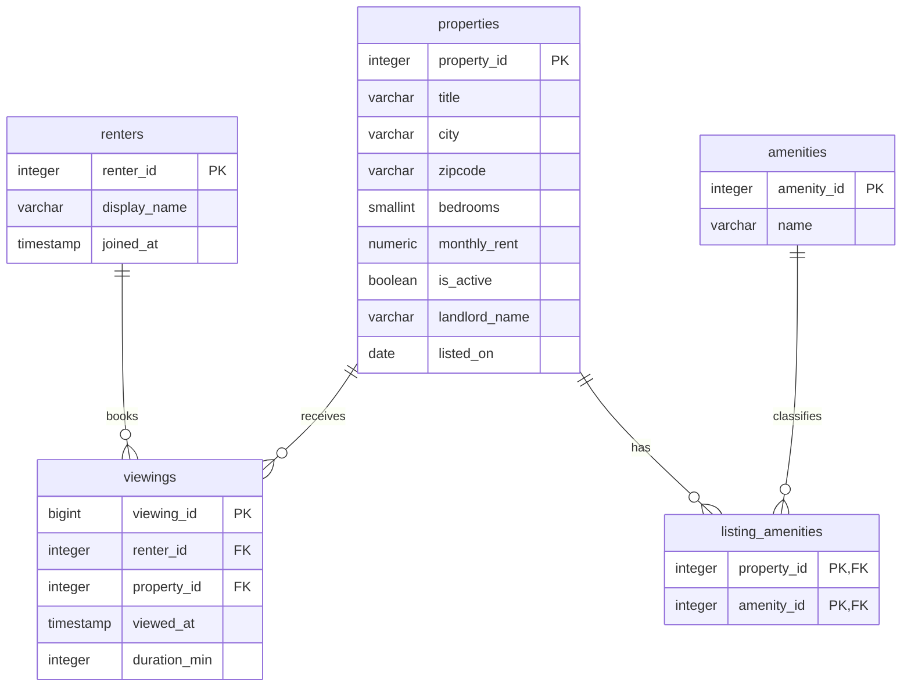

# Task 1.1: Relation Schemas

This covers the five roles from the assignment, mapped to the **Rental Marketplace**
theme. Every domain is a PostgreSQL 14 type. Foreign keys are listed for context. Their
referential actions (`ON DELETE` and so on) are defined in
[`constraints.md`](constraints.md).

| Role | Relation | Primary key |
|------|----------|-------------|
| actor | `renters` | `renter_id` |
| producer | `properties` | `property_id` |
| event | `viewings` | `viewing_id` |
| catalog | `amenities` | `amenity_id` |
| junction | `listing_amenities` | (`property_id`, `amenity_id`) |

Relational notation. Primary-key attributes are <u>underlined</u>, foreign keys are marked `†`:

- **renters**(<u>renter_id</u>, display_name, joined_at)
- **properties**(<u>property_id</u>, title, city, zipcode, bedrooms, monthly_rent, is_active, landlord_name, listed_on)
- **viewings**(<u>viewing_id</u>, renter_id&nbsp;`†`, property_id&nbsp;`†`, viewed_at, duration_min)
- **amenities**(<u>amenity_id</u>, name)
- **listing_amenities**(<u>property_id</u>&nbsp;`†`, <u>amenity_id</u>&nbsp;`†`)

---

## Entity relationship diagram

Read `||--o{` as "exactly one to zero-or-many": every viewing has exactly one renter and
one property, while a renter or property can have any number of viewings. The same holds
for `listing_amenities`, which makes `properties` and `amenities` many-to-many.

---

## 1. renters (actor)

A renter is a user of the platform. They search for a place and book viewings.

| Attribute | Domain (PostgreSQL 14) | Nullable | Description |
|-----------|----------------------|----------|-------------|
| `renter_id` | `INTEGER` `GENERATED ALWAYS AS IDENTITY` | no | Primary key. Auto-generated id. |
| `display_name` | `VARCHAR(100)` | no | Name shown in the UI. |
| `joined_at` | `TIMESTAMP` (default `now()`) | no | Date and time the account was created. |

**Primary key:** `renter_id`

---

## 2. properties (producer)

A property is a rental listing published by a landlord. This is the supply side of the
marketplace.

| Attribute | Domain (PostgreSQL 14) | Nullable | Description |
|-----------|----------------------|----------|-------------|
| `property_id` | `INTEGER` `GENERATED ALWAYS AS IDENTITY` | no | Primary key. Auto-generated id. |
| `title` | `VARCHAR(150)` | no | Name of the listing shown to renters. |
| `city` | `VARCHAR(80)` | no | City the property is in. |
| `zipcode` | `VARCHAR(5)`, `CHECK (zipcode ~ '^[0-9]{5}$')` | no | 5-digit US ZIP code. Finer-grained location than `city` for price analysis. Note the `zipcode` to `city` dependency (see Notes). |
| `bedrooms` | `SMALLINT`, `CHECK (bedrooms >= 0)` | no | Number of bedrooms. `0` means a studio. |
| `monthly_rent` | `NUMERIC(10,2)`, `CHECK (monthly_rent >= 0)` | no | Asking rent per month. This is the attribute used for price filtering. |
| `is_active` | `BOOLEAN` (default `TRUE`) | no | `TRUE` while the listing is on the market, `FALSE` once it is withdrawn or filled. |
| `landlord_name` | `VARCHAR(100)` | no | Name of the landlord who owns the listing. |
| `listed_on` | `DATE` | no | Date the listing went live. |

**Primary key:** `property_id`

---

## 3. viewings (event)

A viewing is one appointment where a renter goes to see a property. This is the table
that grows the fastest, one row per appointment.

| Attribute | Domain (PostgreSQL 14) | Nullable | Description |
|-----------|----------------------|----------|-------------|
| `viewing_id` | `BIGINT` `GENERATED ALWAYS AS IDENTITY` | no | Primary key. `BIGINT` because this table gets large. |
| `renter_id` | `INTEGER` | no | FK to `renters(renter_id)`. Who booked the viewing. |
| `property_id` | `INTEGER` | no | FK to `properties(property_id)`. Which listing was viewed. |
| `viewed_at` | `TIMESTAMP`, `CHECK (viewed_at <= now())` | no | Date and time the viewing took place. |
| `duration_min` | `INTEGER`, `CHECK (duration_min > 0)` | no | Minutes the renter spent at the property. This is the metric the queries aggregate. |

**Primary key:** `viewing_id`
**Foreign keys:** `renter_id` to `renters`, `property_id` to `properties`

---

## 4. amenities (catalog)

An amenity is a feature a listing can advertise, such as parking or air conditioning. The
list is shared so the same feature has one name everywhere.

| Attribute | Domain (PostgreSQL 14) | Nullable | Description |
|-----------|----------------------|----------|-------------|
| `amenity_id` | `INTEGER` `GENERATED ALWAYS AS IDENTITY` | no | Primary key. Auto-generated id. |
| `name` | `VARCHAR(60)`, `UNIQUE` | no | Amenity name, for example `Parking`, `In-unit laundry`, `Pet friendly`, `Air conditioning`. `UNIQUE` so each amenity is stored once. |

**Primary key:** `amenity_id`

---

## 5. listing_amenities (junction)

This table links properties and amenities. Each row says one listing has one amenity.

| Attribute | Domain (PostgreSQL 14) | Nullable | Description |
|-----------|----------------------|----------|-------------|
| `property_id` | `INTEGER` | no | FK to `properties(property_id)`. Part of the composite primary key. |
| `amenity_id` | `INTEGER` | no | FK to `amenities(amenity_id)`. Part of the composite primary key. |

**Primary key:** (`property_id`, `amenity_id`), composite. This also stops the same
amenity being added to a listing twice.
**Foreign keys:** `property_id` to `properties`, `amenity_id` to `amenities`

---

## Notes

- Surrogate keys use `GENERATED ALWAYS AS IDENTITY` instead of `serial`, which is what
  PostgreSQL 14 recommends.
- Money uses `NUMERIC(10,2)` so there is no floating-point rounding.
- `zipcode` and `city` are both kept on `properties` even though `zipcode` determines
  `city`. Splitting location into its own table would be cleaner, but the assignment
  fixes the schema at five tables, so the mild redundancy is accepted here and noted in
  the README's "What I would do differently" section.
- `zipcode` is `VARCHAR`, not a number, because ZIP codes are labels: they can have
  leading zeros and are never used in arithmetic.
- The `CHECK` constraints shown here are the allowed value ranges for each column.
  Foreign-key actions, indexes, and any table-level constraints are in
  [`constraints.md`](constraints.md).
